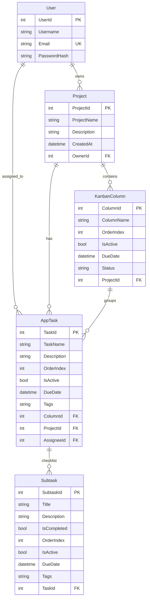

# Agile Task Manager

Ứng dụng quản lý công việc và dự án theo phương pháp **Agile/Kanban** kết hợp **Trình lập kế hoạch Lịch biểu (Weekly Calendar View)**, bao gồm hệ thống **Backend RESTful API** đám mây và ứng dụng **Desktop WPF** hiện đại:

- **AgileTaskManagerAPI** — Backend RESTful API xây dựng trên **ASP.NET Core 8** + **Entity Framework Core 8**, kết nối cơ sở dữ liệu đám mây **PostgreSQL (Neon Cloud)**. Hệ thống đã được Docker hóa (`Dockerfile`) và triển khai trực tuyến trên **Render** (`https://agiletaskmanagerapi.onrender.com`). Tích hợp bảo mật xác thực JWT Bearer và phân quyền vai trò (RBAC).
- **AgileTaskManager.Desktop** — Ứng dụng Desktop **WPF (.NET 8)** gọi trực tiếp API đám mây. Giao diện được thiết kế hiện đại, phối màu hài hòa nịnh mắt (SaaS Clean UI - Segoe UI Variable), chuẩn mực **MVVM**, **Dependency Injection (DI)**, hỗ trợ kéo thả mượt mà với **GongSolutions.WPF.DragDrop** và Native DragDrop.
- **Bản thực thi độc lập (Single-file Executable)** — Đã được đóng gói sẵn thành file chạy duy nhất [`AgileTaskManager.Desktop.exe`](file:///c:/Users/PC/Desktop/FPT_student/DU_AN_CA_NHAN/Project_1_TodoApp/AgileTaskManagerAPI/AgileTaskManager.Desktop.exe) ngay tại thư mục gốc, có thể nhấp đúp chạy ngay trên Windows mà không cần cài đặt .NET Runtime.

---

## 🎨 Hệ thống Thiết kế & Giao diện (Design System)

Ứng dụng sử dụng bảng màu 4 gam màu phối hợp hài hòa, nịnh mắt và độ tương phản cao:

| Màu sắc | Mã màu Hex | Ứng dụng trong giao diện |
|---|---|---|
| **Deep Slate Navy** | `#425B9A` | Thanh tiêu đề chính (Header), nút hành động chính, viền điểm nhấn |
| **Sky Blue** | `#76C0EC` | Nút tab đang chọn, icon đại diện, viền focus input, hiệu ứng hover |
| **Pastel Cream Yellow** | `#FFF6DC` | Nhãn trạng thái danh sách, badge tiến độ, viền ấm `#FCE8A6` |
| **Pastel Coral Pink** | `#FF95A5` | Tab "Tạo mới" nổi bật, nút tạo việc nhanh, avatar đại diện |
| **Slate Dark Text** | `#0F172A` | Màu chữ chính, đảm bảo độ tương phản cao và sắc nét trên nền sáng |
| **Soft Background** | `#F1F5F9` | Nền canvas ứng dụng, dịu mắt khi làm việc thời gian dài |

---

## ✨ Tính năng nổi bật thực tế

### 1. 🔐 Đăng nhập & Bảo mật (Security & Smart Cold Start)
- **Mật khẩu an toàn:** Băm mật khẩu một chiều với thuật toán `BCrypt`.
- **JWT Authentication:** Cấp phát token `JWT Bearer` thời hạn 2 giờ, tự động đính kèm vào HTTP Header trong mọi yêu cầu.
- **Giao diện Đăng nhập chống tràn:** Form card chuẩn tỷ lệ, tự động co giãn với `ScrollViewer`, các khung cảnh báo được ẩn mặc định và chỉ hiển thị khi có thông báo.
- **Cơ chế Pre-warm thông minh:** Ứng dụng tự động gửi request đánh thức máy chủ Render ngay khi mở màn hình đăng nhập, giảm thiểu tối đa thời gian chờ đợi Cold Start.
- **Thông báo Cold Start trực quan:** Hiển thị hướng dẫn thân thiện khi máy chủ đám mây đang thức dậy, không gây hoang mang cho người dùng.

### 2. 📋 Bảng công việc Kanban (Agile Sprint Board)
- **Quản lý danh sách & Cột:**
  - Thêm danh sách mới nhanh chóng (*"Add new list"*).
  - Đổi tên cột trực tiếp (*Inline Title Editing*).
  - Chọn và đổi trạng thái cột linh hoạt (*"Vừa giao"*, *"Đang làm"*, *"Hoàn thành"*, *"Trễ hạn"*).
  - Xóa mềm cột (*Soft Delete* qua cờ `IsActive = false`).
  - Cơ chế **Auto-Heal Order** tự động chuẩn hóa chỉ số thứ tự cột khi phát hiện trùng lặp.
- **Thao tác Thẻ việc (Task Cards):**
  - Thêm nhanh thẻ việc vào từng cột.
  - Kéo thả (Drag & Drop) chuyển thẻ việc giữa các cột mượt mà, tự động cập nhật trạng thái xuống Database.
  - Kéo thả sắp xếp lại vị trí các việc trong cùng một cột.
  - Xóa thẻ việc an toàn.

### 3. 📅 Trình lập kế hoạch Lịch biểu (Weekly Calendar View)
- **Mặc định xem theo tuần:** Khi chuyển sang tab Lịch biểu, ứng dụng mặc định hiển thị chế độ Tuần (*Weekly View*) với đầy đủ các ngày từ Thứ 2 đến Chủ nhật và các khung giờ trong ngày.
- **Cột Chưa xếp lịch thông minh (*Unscheduled Tasks*):**
  - Công việc đã được phân bổ vào các ngày trong tuần hiện tại **sẽ không bị trùng lặp ở cột Chưa xếp lịch**.
  - Chỉ gom những công việc chưa có ngày/giờ cụ thể (hoặc ngoài phạm vi tuần đang chọn).
- **Kéo thả tự do & nhanh nhạy:**
  - Kéo việc từ cột Chưa xếp lịch thả trực tiếp vào ô ngày/giờ trên lưới lịch để tự động ấn định `DueDate`.
  - Kéo thẻ việc giữa các ngày hoặc giữa các khung giờ để đổi lịch tức thì.
- **Bộ điều hướng thời gian:** Dễ dàng chuyển qua lại giữa các tuần (*"Tuần trước"*, *"Tuần này"*, *"Tuần sau"*) hoặc chọn ngày cụ thể qua `DatePicker`.

### 4. 📝 Hộp thoại Chi tiết công việc & Checklist con (Task Details)
- Nhấp vào thẻ việc để mở cửa sổ chi tiết [`TaskDetailWindow`](file:///c:/Users/PC/Desktop/FPT_student/DU_AN_CA_NHAN/Project_1_TodoApp/AgileTaskManagerAPI/AgileTaskManager.Desktop/TaskDetailWindow.xaml):
  - Chỉnh sửa tên công việc, mô tả chi tiết, ngày đến hạn (*Due Date*), nhãn dán (*Tags*).
  - Chỉ định người phụ trách (*Assignee*) với dropdown chữ đậm rõ nét.
  - **Checklist công việc con (Subtasks):** Thêm mới việc con, đánh dấu hoàn thành nhanh bằng Checkbox, sửa tiêu đề trực tiếp và xóa từng mục độc lập.

### 5. 🗂 Điều hướng Single Tab & Form Tạo mới tiện lợi
- **Thanh điều hướng dưới (Bottom Pill Bar):** Chuyển đổi gọn gàng giữa 3 phân hệ chính:
  1. **Bảng thông tin:** Không gian làm việc Kanban tập trung.
  2. **Trình lập kế hoạch:** Lưới lịch biểu tuần trực quan.
  3. **Tạo mới:** Bộ 3 form khởi tạo nhanh:
     - Tạo Người dùng mới (Thành viên).
     - Tạo Dự án mới (Gán Owner).
     - Tạo Công việc mới (Gán dự án, hạn hoàn thành, khung giờ).

---

## 🛠 Ngăn xếp công nghệ (Technology Stack)

| Phân hệ | Công nghệ | Chi tiết |
|---|---|---|
| **Backend API** | ASP.NET Core 8 Web API | Kiến trúc RESTful, Controller-based, C# 12 |
| **ORM & Database** | Entity Framework Core 8, Npgsql | PostgreSQL (Serverless Cloud Neon) |
| **Bảo mật** | JWT Bearer, BCrypt.Net-Next | Mã hóa mật khẩu một chiều, Stateless Auth |
| **DevOps & Cloud** | Docker, Render Cloud | Docker multi-stage build, auto deploy |
| **Desktop Client** | WPF (.NET 8, C#) | XAML, MVVM Pattern, Dependency Injection |
| **Tương tác Kéo thả** | GongSolutions.WPF.DragDrop & Native | Kéo thả mượt mà trên Kanban và Calendar |
| **Thiết kế & Icon** | Segoe Fluent Icons, Segoe UI Variable | Font chữ hiện đại, icon vector chuẩn mực |

---

## 📁 Cấu trúc dự án thực tế

```
AgileTaskManagerAPI/
├── AgileTaskManager.Desktop.exe       # File thực thi độc lập duy nhất (Chạy ngay không cần cài đặt)
├── Dockerfile                         # Cấu hình đóng gói Docker chạy trên Render
├── README.md                          # Tài liệu hướng dẫn dự án
├── AgileTaskManagerAPI.slnx           # File giải pháp Solution (.slnx)
│
├── AgileTaskManager.Desktop/          # Mã nguồn ứng dụng Desktop WPF (.NET 8)
│   ├── App.xaml(.cs)                  # Cấu hình Dependency Injection (ServiceCollection)
│   ├── AppConfig.cs                   # Cấu hình ApiBaseUrl (Render Cloud), HttpClient, JWT Token
│   ├── LoginWindow.xaml(.cs)          # Màn hình đăng nhập, Pre-warm server & xử lý Cold Start
│   ├── DashboardWindow.xaml(.cs)      # Màn hình làm việc chính (Header, Single Tab, Form Tạo mới)
│   ├── CalendarView.xaml(.cs)         # Component Lịch biểu tuần & kéo thả nhiệm vụ
│   ├── KanbanColumn.xaml(.cs)         # Component Cột Kanban, thẻ việc & inline edit
│   ├── TaskDetailWindow.xaml(.cs)     # Cửa sổ chi tiết Task & danh sách Subtasks Checklist
│   ├── Commands/
│   │   └── RelayCommand.cs            # ICommand triển khai cho MVVM
│   ├── ViewModels/
│   │   └── KanbanViewModels.cs        # ViewModel cho Board, Column, Task, Subtask, Calendar
│   └── Services/
│       └── ApiService.cs              # Service layer gọi REST API
│
└── AgileTaskManagerAPI/               # Mã nguồn Backend Web API (ASP.NET Core 8)
    ├── Program.cs                     # Khởi tạo DI, DbContext, JWT, CORS, Health Check
    ├── appsettings.json               # Cấu hình kết nối PostgreSQL Neon, JWT Secret
    ├── Controllers/
    │   ├── AuthController.cs          # Đăng nhập (/api/Auth/login)
    │   ├── UsersController.cs         # Danh sách người dùng & đăng ký (/api/Users)
    │   ├── ProjectsController.cs      # Quản lý dự án (/api/Projects)
    │   ├── ColumnsController.cs       # Quản lý cột Kanban (/api/Columns)
    │   ├── TasksController.cs         # Quản lý thẻ việc (/api/Tasks)
    │   └── SubtasksController.cs      # Quản lý Checklist con (/api/Subtasks)
    ├── Model/                         # Entity Models (User, Project, KanbanColumn, AppTask, Subtask)
    ├── Data/                          # AppDbContext (EF Core)
    └── wwwroot/
        ├── admin.html                 # Giao diện Web Admin hỗ trợ quản lý dữ liệu nhanh
        └── index.html                 # Trang demo thử nghiệm API
```

---

## 🗄 Mô hình cơ sở dữ liệu (Database Schema)



---

## 📡 Danh sách API Endpoints chính

Mọi request (trừ login/register/health) đều yêu cầu Header: `Authorization: Bearer <TOKEN>`.

| Nhóm | Phương thức | Endpoint | Mô tả |
|---|---|---|---|
| **Health** | `GET` | `/api/health` | Kiểm tra tình trạng server & Pre-warm Render |
| **Auth** | `POST` | `/api/Auth/login` | Đăng nhập nhận JWT Token |
| **Users** | `POST` | `/api/Users/register` | Đăng ký tài khoản mới |
| | `GET` | `/api/Users` | Lấy danh sách thành viên |
| **Projects** | `GET` | `/api/Projects` | Lấy danh sách dự án khả dụng |
| | `POST` | `/api/Projects` | Tạo dự án mới |
| **Columns** | `GET` | `/api/Columns/project/{projectId}` | Lấy danh sách cột theo dự án (tự động Auto-Heal) |
| | `POST` | `/api/Columns` | Tạo cột mới |
| | `PUT` | `/api/Columns/{id}` | Cập nhật tên, trạng thái cột |
| | `DELETE`| `/api/Columns/{id}` | Xóa mềm cột |
| | `PUT` | `/api/Columns/reorder` | Sắp xếp lại thứ tự các cột |
| **Tasks** | `GET` | `/api/Tasks/project/{projectId}` | Lấy toàn bộ công việc theo dự án |
| | `POST` | `/api/Tasks` | Tạo công việc mới |
| | `PUT` | `/api/Tasks/{id}` | Cập nhật thông tin công việc |
| | `DELETE`| `/api/Tasks/{id}` | Xóa mềm công việc |
| | `PATCH` | `/api/Tasks/{id}/column` | Chuyển cột (khi kéo thả Kanban) |
| | `PUT` | `/api/Tasks/reorder` | Sắp xếp lại thứ tự công việc |
| **Subtasks**| `POST` | `/api/Subtasks/{taskId}` | Tạo việc con Checklist |
| | `PUT` | `/api/Subtasks/{subtaskId}` | Cập nhật tiêu đề / trạng thái hoàn thành |
| | `DELETE`| `/api/Subtasks/{subtaskId}` | Xóa việc con |

---

## 🚀 Hướng dẫn Khởi chạy Ứng dụng

### Cách 1: Chạy ngay file thực thi (Khuyến nghị)
Ứng dụng đã được đóng gói thành file thực thi duy nhất tự tích hợp runtime:
1. Nhấp đúp trực tiếp vào file:
   ```
   AgileTaskManager.Desktop.exe
   ```
   (ngay tại thư mục gốc của dự án).
2. Ứng dụng sẽ tự động kết nối đến Backend Render Cloud (`https://agiletaskmanagerapi.onrender.com`).
3. Đăng nhập với tài khoản có sẵn hoặc tạo mới qua Web Admin (`admin.html`).

> [!NOTE]
> Do Backend sử dụng gói miễn phí của Render, nếu không có request trong một khoảng thời gian, server sẽ rơi vào trạng thái ngủ (*Cold Start*). Khi mở ứng dụng lần đầu, vui lòng đợi khoảng 30–50 giây để máy chủ khởi động hoàn tất.

---

### Cách 2: Chạy từ Mã nguồn (Visual Studio / .NET CLI)
Yêu cầu máy tính đã cài đặt **.NET SDK 8.0+** trên hệ điều hành Windows:

```bash
# 1. Chạy ứng dụng Desktop
cd AgileTaskManager.Desktop
dotnet run

# 2. (Tùy chọn) Chạy Backend API trên máy Local
cd ../AgileTaskManagerAPI
dotnet run
```

Nếu chạy Backend Local (`http://localhost:5279`), bạn chỉ cần cập nhật `ApiBaseUrl` trong [AppConfig.cs](file:///c:/Users/PC/Desktop/FPT_student/DU_AN_CA_NHAN/Project_1_TodoApp/AgileTaskManagerAPI/AgileTaskManager.Desktop/AppConfig.cs) về `http://localhost:5279/api`.

---

## 🤝 Đóng góp & Phát triển

Mọi ý kiến đóng góp, báo cáo lỗi hoặc đề xuất cải tiến vui lòng mở **Issue** hoặc tạo **Pull Request** trên GitHub.

