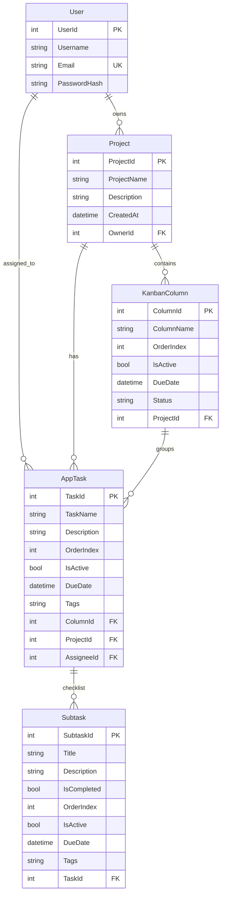

# Agile Task Manager

Ứng dụng quản lý công việc và dự án theo phương pháp Agile/Kanban kết hợp Lịch biểu (Calendar View), bao gồm hệ thống Backend API triển khai đám mây và ứng dụng Desktop WPF hiện đại:

- **AgileTaskManagerAPI** — Backend RESTful API xây dựng trên **ASP.NET Core 8** + **Entity Framework Core 8**, sử dụng cơ sở dữ liệu đám mây **PostgreSQL (Neon)**. Hệ thống đã được Docker hóa (`Dockerfile`) và triển khai trực tuyến trên nền tảng **Render** (`https://agiletaskmanagerapi.onrender.com`). Tích hợp bảo mật toàn diện với xác thực JWT và phân quyền người dùng (RBAC).
- **AgileTaskManager.Desktop** — Ứng dụng Desktop **WPF (.NET 8)** gọi trực tiếp API đám mây. Được thiết kế theo ngôn ngữ phẳng hiện đại (Clean SaaS UI - Segoe UI Variable), tuân thủ kiến trúc **MVVM (Model-View-ViewModel)** chuẩn mực, **Dependency Injection (DI)**, hỗ trợ kéo thả mượt mà với **GongSolutions.WPF.DragDrop** và Native DragDrop.

---

## ✨ Tính năng nổi bật

### 1. 🔐 Bảo mật & Phân quyền (Security & RBAC)
- **Đăng ký & Đăng nhập:** Mật khẩu người dùng được băm an toàn bằng thuật toán `BCrypt`.
- **JWT Authentication:** Cấp phát token `JSON Web Token (JWT Bearer)` thời hạn 2 giờ, tự động đính kèm vào HTTP Header trong mọi yêu cầu.
- **Phân quyền vai trò (Role-Based Access Control):**
  - **Quản trị viên (`admin`):** Toàn quyền truy cập và quản lý mọi dự án trong toàn bộ hệ thống; có đặc quyền tạo User mới, tạo Project và chỉ định Owner bất kỳ.
  - **Người dùng thường:** Chỉ xem, tạo và chỉnh sửa các dự án do chính mình làm chủ (`OwnerId`); giao diện tự động ẩn chức năng tạo tài khoản và tự dàn lại layout.
- **CORS & Bảo vệ API:** Bộ lọc chặt chẽ thông qua chính sách `StrictCorsPolicy` và kiểm tra quyền sở hữu dữ liệu.

### 2. 📋 Bảng Kanban trực quan (Interactive Kanban Board)
- **Quản lý danh sách & cột:**
  - Tự động đồng bộ thứ tự danh sách theo `OrderIndex`.
  - Cơ chế **Auto-Heal** tự động sửa lỗi và chuẩn hóa thứ tự cột khi phát hiện trùng chỉ số.
  - Thêm mới danh sách công việc nhanh (*"Add new list"*).
  - Đổi tên cột trực tiếp ngay trên giao diện (*Inline Title Editing*).
  - Lựa chọn và cập nhật trạng thái cột linh hoạt (*"Vừa giao"*, *"Đang làm"*, *"Hoàn thành"*, *"Trễ hạn"*).
  - Xóa cột an toàn (*Soft Delete* thông qua cờ `IsActive = false`).
- **Thao tác thẻ việc (Task Cards):**
  - Thêm thẻ việc nhanh vào từng cột danh sách.
  - Kéo thả (Drag & Drop) chuyển thẻ việc giữa các cột và cập nhật ngay lập tức xuống cơ sở dữ liệu.
  - Kéo thả sắp xếp lại thứ tự các thẻ trong cùng một cột.
  - Xóa thẻ việc an toàn (*Soft Delete*).

### 3. 📅 Lịch biểu tuần tương tác (Weekly Calendar View)
- Chuyển đổi linh hoạt giữa Bảng Kanban và Chế độ Lịch biểu theo tuần.
- Xem danh sách công việc theo từng khung giờ và ngày trong tuần.
- Bộ điều khiển thời gian: Nút chuyển tuần (*"Tuần trước"*, *"Tuần hiện tại"*, *"Tuần sau"*) hoặc chọn ngày bất kỳ thông qua `DatePicker`.
- **Khu vực Chưa xếp lịch (*Unscheduled Tasks*):** Tự động gom các công việc chưa có ngày/giờ cụ thể vào danh sách riêng.
- **Kéo thả lên Lịch:** Kéo thẻ từ danh sách chưa xếp lịch thả vào ô ngày/giờ mong muốn để tự động gắn `DueDate` hoặc kéo đổi lịch làm việc.
- Chỉnh sửa nhanh tiêu đề và trạng thái công việc trực tiếp trong giao diện Lịch biểu.
- Đồng bộ dữ liệu hai chiều thời gian thực giữa Kanban Board và Calendar View.

### 4. 📝 Chi tiết công việc & Checklist con (Task Details & Subtasks)
- Màn hình chi tiết công việc (`TaskDetailWindow`) cho phép quản lý:
  - Tên công việc (*Task Name*), Mô tả chi tiết (*Description*).
  - Thời hạn hoàn thành (*Due Date*), Nhãn phân loại (*Tags*).
  - Người thực hiện (*Assignee* - gán thành viên trong nhóm).
- **Checklist công việc con (Subtasks):**
  - Thêm mới các đầu việc con cho từng thẻ việc.
  - Đánh dấu hoàn thành trực tiếp bằng checkbox.
  - Đổi tên công việc con trực tiếp (*Inline Edit*).
  - Xóa công việc con độc lập.

### 5. ⚡ Tối ưu trải nghiệm Đám mây (Cloud & Cold Start UX)
- **Cơ chế Pre-warm thông minh:** Ứng dụng Desktop tự động gửi tín hiệu giữ ấm/đánh thức máy chủ Render thông qua endpoint `/api/health` ngay khi mở màn hình đăng nhập.
- **Thông báo trạng thái Cold Start:** Trong trường hợp máy chủ Render đang ở chế độ ngủ (Free Tier Idle), màn hình hiển thị thanh tiến trình và thông báo hướng dẫn người dùng chờ đợi thay vì báo lỗi mất kết nối.

### 6. 🌐 Giao diện Web Quản trị (`admin.html` & `index.html`)
- Tích hợp sẵn trong thư mục `wwwroot` của Backend.
- `admin.html`: Bảng điều khiển web hỗ trợ đăng nhập JWT, tạo nhanh dữ liệu thử nghiệm (User, Project, Task) và hiển thị trực quan toàn bộ bảng dữ liệu.
- `index.html`: Giao diện web Kanban mẫu kết nối thử nghiệm API.

---

## 🛠 Công nghệ sử dụng

| Phân hệ | Công nghệ / Thư viện | Mô tả |
|---|---|---|
| **Backend** | ASP.NET Core 8 Web API | Kiến trúc RESTful API, Controller-based |
| **ORM & Database** | Entity Framework Core 8, Npgsql | PostgreSQL (Serverless Cloud Neon) |
| **Authentication** | JWT Bearer Token, BCrypt.Net-Next | Mã hóa mật khẩu một chiều, xác thực phi trạng thái |
| **DevOps / Cloud** | Docker, Render Cloud | Multi-stage build Dockerfile, hosting tự động |
| **Desktop Client** | WPF (.NET 8, C#) | XAML, Fluent Icons, Segoe UI Variable |
| **Kiến trúc Desktop** | MVVM Pattern, Dependency Injection | `ObservableCollection`, `ICommand`, `Microsoft.Extensions.DependencyInjection` |
| **Drag & Drop** | GongSolutions.WPF.DragDrop & Native DragDrop | Hỗ trợ kéo thả trên Kanban và lưới Lịch biểu |
| **Tài liệu API** | Swagger / OpenAPI (Swashbuckle) | Khám phá và kiểm thử endpoint trực quan |

---

## 📁 Cấu trúc thư mục

```
AgileTaskManagerAPI/
├── AgileTaskManager.Desktop/          # Ứng dụng Desktop WPF (.NET 8)
│   ├── App.xaml(.cs)                  # Cấu hình Dependency Injection (ServiceCollection) & Unhandled Exceptions
│   ├── AppConfig.cs                   # Cấu hình tĩnh: ApiBaseUrl, HttpClient dùng chung, JWT Token
│   ├── LoginWindow.xaml(.cs)          # Màn hình đăng nhập, cơ chế Pre-warm & Cold Start notification
│   ├── DashboardWindow.xaml(.cs)      # Màn hình chính (Sidebar, Kanban Board, Form Create)
│   ├── CalendarView.xaml(.cs)         # Component xem lịch biểu theo tuần & kéo thả nhiệm vụ
│   ├── KanbanColumn.xaml(.cs)         # Component hiển thị Cột Kanban, thẻ việc & inline edit
│   ├── TaskDetailWindow.xaml(.cs)     # Hộp thoại chỉnh sửa chi tiết Task & danh sách Subtasks (Checklist)
│   ├── Commands/
│   │   └── RelayCommand.cs            # Triển khai ICommand cho MVVM Binding
│   ├── ViewModels/
│   │   └── KanbanViewModels.cs        # ViewModel cho Board, Column, Task, Subtask, Calendar
│   └── Services/
│       └── ApiService.cs              # Service layer đóng gói toàn bộ lời gọi HTTP REST API
│
├── AgileTaskManagerAPI/               # Backend Web API (ASP.NET Core 8)
│   ├── Program.cs                     # Cấu hình DI, DbContext (Npgsql), JWT, CORS, Auto-Migration, Health Check
│   ├── Dockerfile                     # Multi-stage Docker build phục vụ triển khai lên Render
│   ├── appsettings.json               # Cấu hình JWT, ConnectionString (PostgreSQL Neon), CORS
│   ├── Controllers/
│   │   ├── AuthController.cs          # Xác thực đăng nhập (/api/Auth/login)
│   │   ├── UsersController.cs         # Đăng ký & lấy danh sách người dùng (/api/Users)
│   │   ├── ProjectsController.cs      # Quản lý dự án (/api/Projects)
│   │   ├── ColumnsController.cs       # Quản lý cột Kanban, đổi tên, reorder (/api/Columns)
│   │   ├── TasksController.cs         # Quản lý thẻ việc, chuyển cột, reorder (/api/Tasks)
│   │   └── SubtasksController.cs      # Quản lý việc con Checklist (/api/Subtasks)
│   ├── Model/
│   │   ├── User.cs                    # Model người dùng
│   │   ├── Project.cs                 # Model dự án
│   │   ├── KanbanColumn.cs            # Model cột danh sách
│   │   ├── AppTask.cs                 # Model thẻ việc
│   │   ├── Subtask.cs                 # Model công việc con (Checklist)
│   │   └── LoginRequest.cs            # DTO đăng nhập
│   ├── Data/
│   │   └── AppDbContext.cs            # EF Core DbContext cấu hình quan hệ bảng
│   └── wwwroot/
│       ├── admin.html                 # Công cụ Web Admin quản trị dữ liệu
│       └── index.html                 # Trang web Kanban demo mẫu
│
├── Publish/                           # Thư mục chứa bản build thực thi đã xuất xưởng
│   └── AgileTaskManager.Desktop.exe   # Bản chạy độc lập của ứng dụng Desktop
└── AgileTaskManagerAPI.slnx           # File giải pháp Solution (.slnx)
```

---

## 🗄 Mô hình dữ liệu (Database Schema)

Hệ thống sử dụng cơ sở dữ liệu quan hệ **PostgreSQL**:



---

## 📡 Danh sách API Endpoints

Hầu hết các endpoint yêu cầu gửi kèm Header: `Authorization: Bearer <TOKEN>` (ngoại trừ các endpoint Public).

### 1. Hệ thống & Giữ ấm (System & Health)
| Phương thức | Endpoint | Mô tả | Quyền truy cập |
|---|---|---|---|
| `GET` | `/api/health` | Kiểm tra sức khỏe hệ thống & Pre-warm máy chủ Render | Public |

### 2. Xác thực & Người dùng (Auth & Users)
| Phương thức | Endpoint | Mô tả | Quyền truy cập |
|---|---|---|---|
| `POST` | `/api/Auth/login` | Đăng nhập bằng Email/Password, nhận JWT Token | Public |
| `POST` | `/api/Users/register` | Đăng ký tài khoản người dùng mới | Public |
| `GET` | `/api/Users` | Lấy danh sách toàn bộ người dùng (Id, Username, Email) | Bearer Token |

### 3. Dự án (Projects)
| Phương thức | Endpoint | Mô tả | Quyền truy cập |
|---|---|---|---|
| `GET` | `/api/Projects` | Lấy danh sách dự án (Admin: tất cả; User thường: dự án của mình) | Bearer Token |
| `POST` | `/api/Projects` | Tạo dự án mới | Bearer Token |

### 4. Cột Kanban (Columns)
| Phương thức | Endpoint | Mô tả | Quyền truy cập |
|---|---|---|---|
| `GET` | `/api/Columns/project/{projectId}` | Lấy danh sách cột theo dự án (tự động Auto-Heal thứ tự) | Bearer Token |
| `POST` | `/api/Columns` | Tạo cột mới | Bearer Token |
| `PUT` | `/api/Columns/{id}` | Cập nhật tên cột, trạng thái hoặc thời hạn | Bearer Token |
| `DELETE` | `/api/Columns/{id}` | Xóa mềm cột (`IsActive = false`) | Bearer Token |
| `PUT` | `/api/Columns/reorder` | Cập nhật vị trí danh sách theo thứ tự mới | Bearer Token |

### 5. Thẻ việc (Tasks)
| Phương thức | Endpoint | Mô tả | Quyền truy cập |
|---|---|---|---|
| `GET` | `/api/Tasks` | Lấy tất cả công việc | Bearer Token |
| `GET` | `/api/Tasks/project/{projectId}` | Lấy danh sách công việc thuộc một dự án cụ thể | Bearer Token |
| `POST` | `/api/Tasks` | Tạo công việc mới | Bearer Token |
| `PUT` | `/api/Tasks/{id}` | Cập nhật thông tin công việc (Tên, Mô tả, Hạn, Tags, Assignee) | Bearer Token |
| `DELETE` | `/api/Tasks/{id}` | Xóa mềm công việc (`IsActive = false`) | Bearer Token |
| `PATCH` | `/api/Tasks/{id}/column` | Chuyển thẻ sang cột khác (khi kéo thả Kanban) | Bearer Token |
| `PUT` | `/api/Tasks/reorder` | Sắp xếp lại thứ tự công việc | Bearer Token |

### 6. Việc con Checklist (Subtasks)
| Phương thức | Endpoint | Mô tả | Quyền truy cập |
|---|---|---|---|
| `POST` | `/api/Subtasks/{taskId}` | Tạo việc con mới thuộc công việc cha | Bearer Token |
| `PUT` | `/api/Subtasks/{subtaskId}` | Cập nhật tiêu đề hoặc trạng thái hoàn thành việc con | Bearer Token |
| `DELETE` | `/api/Subtasks/{subtaskId}` | Xóa việc con | Bearer Token |

---

## 🚀 Hướng dẫn Cài đặt & Khởi chạy

### Yêu cầu môi trường
- **.NET SDK 8.0+**
- Hệ điều hành **Windows 10/11** (để chạy ứng dụng WPF)
- Visual Studio 2022 (khuyến nghị có cài đặt workload *.NET Desktop Development*) hoặc VS Code / .NET CLI.

---

### Cách 1: Chạy trực tiếp Ứng dụng Desktop (Kết nối Cloud API sẵn có)
Ứng dụng Desktop đã được cấu hình mặc định trỏ đến API đám mây Render: `https://agiletaskmanagerapi.onrender.com/api`.

1. Khởi chạy file thực thi đã biên dịch sẵn trong thư mục `Publish/`:
   ```bash
   ./Publish/AgileTaskManager.Desktop.exe
   ```
2. Hoặc mở mã nguồn và chạy bằng .NET CLI:
   ```bash
   cd AgileTaskManager.Desktop
   dotnet run
   ```
3. Đăng nhập với tài khoản có sẵn hoặc đăng ký tài khoản mới qua trang web `https://agiletaskmanagerapi.onrender.com/admin.html`.

> [!NOTE]
> Do Backend chạy trên gói miễn phí của Render, nếu không có yêu cầu nào trong một khoảng thời gian máy chủ sẽ tạm ngủ (Cold Start). Khi mở ứng dụng Desktop lần đầu, vui lòng đợi từ 30–50 giây để máy chủ khởi động lại.

---

### Cách 2: Tự khởi chạy Backend API ở môi trường Local

#### Bước 1: Cấu hình Cơ sở dữ liệu PostgreSQL
Mở file `AgileTaskManagerAPI/appsettings.json` và cấu hình chuỗi kết nối:
```json
"ConnectionStrings": {
  "DefaultConnection": "Host=localhost;Port=5432;Database=AgileTaskManagerDB;Username=postgres;Password=your_password;"
}
```

#### Bước 2: Chạy Backend API
```bash
cd AgileTaskManagerAPI
dotnet restore
dotnet run
```
API sẽ khởi chạy tại `http://localhost:5279` (hoặc cổng cấu hình trong `launchSettings.json`). Database sẽ tự động được chạy `Migrate()` khi khởi động.
- Truy cập Swagger API Docs: `http://localhost:5279/swagger`
- Truy cập Công cụ Web Admin: `http://localhost:5279/admin.html`

#### Bước 3: Chuyển cấu hình Desktop App sang Local
Mở file [AppConfig.cs](file:///c:/Users/PC/Desktop/FPT_student/DU_AN_CA_NHAN/Project_1_TodoApp/AgileTaskManagerAPI/AgileTaskManager.Desktop/AppConfig.cs) và cập nhật đường dẫn:
```csharp
public static readonly string ApiBaseUrl = "http://localhost:5279/api";
```
Sau đó khởi động `AgileTaskManager.Desktop` để kết nối vào Local API.

---

## 🗺 Lịch sử phát triển & Tính năng đã hoàn thành

- [x] Kiến trúc Backend REST API trên ASP.NET Core 8 & Entity Framework Core 8.
- [x] Chuyển đổi và hỗ trợ cơ sở dữ liệu đám mây PostgreSQL (Neon Cloud DB).
- [x] Mã hóa mật khẩu bảo mật (BCrypt) & Xác thực phân quyền không trạng thái (JWT Bearer).
- [x] Cơ chế phân quyền theo vai trò (RBAC): Toàn quyền Admin vs Quyền sở hữu của Nhân viên.
- [x] Giao diện WPF hiện đại (Clean SaaS Design, Segoe UI Variable, chuẩn MVVM & Dependency Injection).
- [x] Kéo thả linh hoạt thẻ việc và danh sách trên Bảng Kanban (GongSolutions.WPF.DragDrop).
- [x] Quản lý Lịch biểu tuần (Weekly Calendar View) hỗ trợ kéo thả nhiệm vụ và đặt lịch.
- [x] Hộp thoại chi tiết công việc với Checklist con (Subtasks) và gán nhãn, hạn chót.
- [x] Docker hóa ứng dụng Backend và triển khai trực tuyến lên Render Cloud.
- [x] Tối ưu trải nghiệm tải chậm khi khởi động máy chủ đám mây (Pre-warm & Cold Start UX).
- [x] Bảng điều khiển Web Admin hỗ trợ quản lý dữ liệu nhanh chóng (`admin.html`).

---

## 🤝 Đóng góp & Bản quyền

Mọi đóng góp, báo cáo lỗi hoặc đề xuất cải tiến tính năng đều được hoan nghênh. Vui lòng tạo Issue hoặc Pull Request trên kho lưu trữ.
